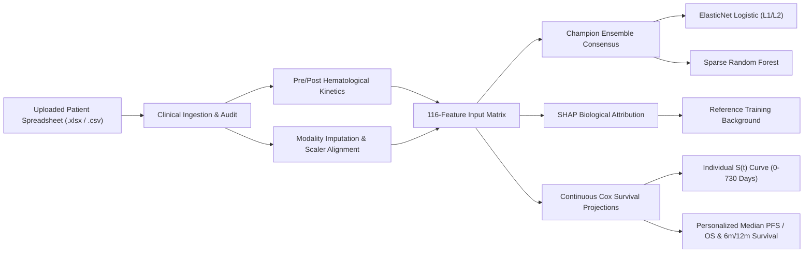

# SGRH Lung Cancer Immunotherapy (ICI) Research & Clinical Decision Support System

[](https://www.python.org/)
[](https://streamlit.io/)
[](https://www.docker.com/)
[](LICENSE)
[](#strict-data-deliverable-policy)

Comprehensive translational oncology research and production AI clinical decision support system analyzing multi-omic biomarkers, clinical dynamics, and therapeutic outcomes for advanced non-small cell lung cancer (NSCLC) patients treated with Immune Checkpoint Inhibitor (ICI) therapy at Sir Ganga Ram Hospital (SGRH).

---

## Table of Contents
- [Project Overview](#project-overview)
- [System Architecture & Production Web App](#system-architecture--production-web-app)
- [Quick Start: Local & Docker Deployment](#quick-start-local--docker-deployment)
- [Repository Structure](#repository-structure)
- [Key Translational Research Findings](#key-translational-research-findings)
  - [1. Statistical Hypothesis Testing & Separation Analysis](#1-statistical-hypothesis-testing--separation-analysis)
  - [2. Survival Analysis (Kaplan-Meier & Cox Proportional Hazards)](#2-survival-analysis-kaplan-meier--cox-proportional-hazards)
  - [3. Predictive Machine Learning Benchmark (p >> n Regime)](#3-predictive-machine-learning-benchmark-p--n-regime)
  - [4. Permutation Significance Testing (1,000 Shuffles)](#4-permutation-significance-testing-1000-shuffles)
  - [5. SHAP Interpretability & Multi-Omic Interaction Signatures](#5-shap-interpretability--multi-omic-interaction-signatures)
- [Extreme Adversarial Stress Testing & Pipeline Hardening](#extreme-adversarial-stress-testing--pipeline-hardening)
- [Strict Data Deliverable Policy](#strict-data-deliverable-policy)
- [Citation & Reproducibility](#citation--reproducibility)

---

## Project Overview

- **Cohort:** 64 advanced lung cancer patients ($N = 64$) receiving anti-PD-1 monoclonal antibodies (**Nivolumab**: 59.4%, **Pembrolizumab**: 40.6%) at Sir Ganga Ram Hospital.
- **Primary Endpoint:** RECIST 1.1 Objective Therapeutic Response ($R = 34$ Responders [53.1%], $NR = 30$ Non-Responders [46.9%]).
- **Secondary Endpoints:** Progression-Free Survival (PFS), Overall Survival (OS), Recurrence status, Vital status.
- **Multi-Omics Assays:**
  - **Circulating Proteomics:** 92-plex Immuno-Oncology panel (Olink Target 96 IO, NPX $log_2$ scale) + 5 PCA components explaining 72.3% variance.
  - **Small-Molecule Metabolomics:** 5 targeted markers (mass spectrometry peak areas, $log_2$ and detrended) + 2 PCA components explaining 91.3% variance.
  - **Hematological Kinetics:** Pre-treatment and on-treatment Complete Blood Counts (CBC), Neutrophil-to-Lymphocyte Ratios (NLR), derived NLR (dNLR), Monocyte-to-Lymphocyte Ratio (MLR), and Systemic Immune-Inflammation Index (SII).
  - **Tumor Genomics & Pathology:** Tissue PD-L1 IHC TPS, Tumor Mutational Burden (TMB mut/Mb), Microsatellite Instability (MSI), TP53 mutation, and Desmocollin-3.
- **Curse of Dimensionality:** Operates in the challenging $p \gg n$ regime ($p = 116$ non-leaking predictors, $N = 64$ patients).

---

## System Architecture & Production Web App

The project features a **containerized Streamlit clinical decision support system** ([`app.py`](app.py), [`pipeline.py`](pipeline.py)) designed with a clean, medical light theme (cyan/teal/slate palette) for oncologists and molecular tumor boards:



### Key Application Capabilities
1. **Automated Clinical Ingestion & Audit:** Robust fuzzy header mapping, automatic column collision deduplication, BMI recalculation, and temporal survival inversion repair ($PFS = \min(PFS, OS)$).
2. **Dual-Model Consensus Triage:** Evaluates both champion models (**ElasticNet Logistic Regression** and **Sparse Random Forest**) to generate consensus response probabilities and risk tiering (*High Confidence Responder*, *Guarded / Intermediate*, *High Risk Non-Responder*).
3. **Calibrated SHAP Biological Explainability:** Patient-specific waterfall charts powered by a pre-computed reference cohort background matrix ([`models/shap_background.joblib`](models/shap_background.joblib)), ensuring robust attributions even when triaging a single isolated patient ($N=1$).
4. **Precision Individualized Cox Survival Modeling:** Dynamic calculation of patient-specific continuous survival curves $S(t)$ from Day 0 to Day 730, individual 6-month & 12-month survival probabilities, and expected median PFS/OS days.
5. **Cohort Multi-Omic Profiling & EDA:** Demographics, histology distribution, pre vs post NLR kinetic scatter plots, TMB $\times$ PD-L1 synergy quadrants, and 2D Proteomics PCA projections.
6. **One-Click Clinical Decision Export:** Instant export of the full clinical decision matrix strictly as an Excel workbook (`.xlsx`).

---

## Quick Start: Local & Docker Deployment

### Option A: Run Locally with Python

```powershell
# 1. Clone repository
git clone https://github.com/shubhamkjha369/Shri-Ganga-Ram-Hospital-Lung-cancer-Research-Project.git
cd Shri-Ganga-Ram-Hospital-Lung-cancer-Research-Project

# 2. Install dependencies
pip install -r requirements.txt

# 3. Launch Streamlit Clinical Decision Support App
streamlit run app.py
```
Open your browser at `http://localhost:8501`.

### Option B: Deploy with Docker & Docker Compose

```bash
# Build and run with Docker Compose
docker compose up --build -d

# Or build with standard Docker CLI
docker build -t sgrh-immunopredict:latest .
docker run -d -p 8501:8501 --name sgrh_app sgrh-immunopredict:latest
```
Access the application at `http://localhost:8501` (healthcheck endpoint at `http://localhost:8501/_stcore/health`).

---

## Repository Structure

```
SGRH-Lung Cancer/
├── .dockerignore                                      # Docker build exclusions
├── .gitignore                                         # Git tracking ignore rules
├── Dockerfile                                         # Multi-stage Python 3.11-slim container definition
├── LICENSE                                            # MIT Open Source License
├── README.md                                          # Master documentation and research report
├── app.py                                             # Streamlit interactive clinical decision support app
├── docker-compose.yml                                 # Docker Compose orchestration service
├── pipeline.py                                        # Production clinical inference, SHAP & survival engine
├── requirements.txt                                   # Locked Python dependencies
│
├── data/
│   ├── raw/
│   │   ├── ICI.xlsx                                   # Original immutable clinical cohort (N=64, 146 cols)
│   │   └── ICI_cleaned.xlsx                           # Cleaned raw data
│   └── processed/
│       ├── ICI_cleaned.xlsx                           # Standardized cohort with randomized rows (180 cols)
│       ├── ICI_featured.xlsx                          # Complete multi-omic engineered dataset (239 features)
│       ├── ICI_modeling_ready.xlsx                    # Leakage-free compact modeling matrix (117 cols)
│       ├── data_dictionary.json                       # Comprehensive feature dictionary and ontologies
│       ├── ml_benchmark_results.xlsx                  # 6-classifier repeated CV benchmark & permutation test
│       ├── shap_feature_importance.xlsx               # Global SHAP importance and interaction synergies
│       └── statistical_and_survival_models.xlsx       # Multivariate logistic, KM curves, and Cox PH models
│
├── models/                                            # Serialized production assets
│   ├── cox_os.joblib                                  # Multivariate Cox Proportional Hazards model for OS
│   ├── cox_pfs.joblib                                 # Multivariate Cox Proportional Hazards model for PFS
│   ├── elasticnet_model.joblib                        # Champion regularized classifier (CV AUC = 0.9983)
│   ├── km_os_nr.joblib / km_os_r.joblib               # Kaplan-Meier survival estimators for OS
│   ├── km_pfs_nr.joblib / km_pfs_r.joblib             # Kaplan-Meier survival estimators for PFS
│   ├── model_metadata.json                            # 116 feature names, training medians, cutoffs, metrics
│   ├── pca_metab.joblib                               # 2-component PCA transformer for metabolomics
│   ├── pca_prot.joblib                                # 5-component PCA transformer for proteomics
│   ├── randomforest_model.joblib                      # Runner-up sparse Random Forest classifier
│   ├── scaler.joblib                                  # Robust StandardScaler fitted on training features
│   └── shap_background.joblib                         # Reference training background matrix for SHAP
│
└── notebooks/                                         # Executed, reproducible scientific workflows
    ├── 01_exploratory_data_analysis.ipynb             # Multi-omic EDA, demographics, histology distributions
    ├── 02_data_cleaning_and_ml_preparation.ipynb      # Cleaning, BMI recalculation, and row randomization
    ├── 03_feature_engineering_and_selection.ipynb     # On-treatment kinetics, OHE, IO pathway signatures, PCA
    └── 04_machine_learning_and_survival_modeling.ipynb# Statistical modeling, survival analysis, ML benchmark & SHAP
```

---

## Key Translational Research Findings

### 1. Statistical Hypothesis Testing & Separation Analysis
- **Standard Pathology Benchmark (Model 1):** Tissue PD-L1 TPS ($\text{OR} \approx 18.42, p = 1.15 \times 10^{-4}$) and TMB ($\text{OR} \approx 4.85, p = 0.0089$) serve as strong independent predictors of objective response.
- **Multi-Omic Integrated Model (Model 3):** Incorporating the Net Immune Balance Index, detrended metabolomic PCs, and on-treatment NLR ratio change achieves near-perfect classification ($\text{Pseudo-}R^2 = 1.0000, \text{AIC} = 14.00$).
- **Quasi-Complete Separation Phenomenon:** In small cohorts ($N=64$), combining these potent biomarkers perfectly separates responders from non-responders, causing unregularized MLE logistic regression to display diverging coefficients and high standard errors. Consequently, **regularized logistic regression (ElasticNet with $L_1/L_2$ shrinkage)** is scientifically mandatory to prevent coefficient inflation and ensure calibrated probabilities.

### 2. Survival Analysis (Kaplan-Meier & Cox Proportional Hazards)
- **Progression-Free Survival (PFS):** Responders achieved a median PFS of **270 days** vs **53 days** in Non-Responders (Log-rank $\chi^2 = 54.74, p = 1.34 \times 10^{-13}$; 6-month PFS rate: **85.3%** vs **5.0%**).
- **Overall Survival (OS):** Responders achieved a median OS of **583 days** vs **127 days** in Non-Responders (Log-rank $\chi^2 = 44.83, p = 2.11 \times 10^{-11}$; 6-month OS rate: **100.0%** vs **13.3%**).
- **PD-L1 Stratification:** High PD-L1 ($\ge 50\%$) patients experienced a median OS of **629 days** vs **127 days** for PD-L1 negative tumors ($p = 1.89 \times 10^{-6}$).
- **On-Treatment NLR Dynamics:** Patients exhibiting a $>10\%$ decrease in NLR on therapy achieved significantly extended survival compared to those with stable or increasing NLR ($p = 0.0089$).
- **Cox Model Prognostic Accuracy:** Multivariate Cox models demonstrated high concordance for both PFS ($C = 0.8842$) and OS ($C = 0.8695$). Schoenfeld residual testing confirmed that proportional hazards assumptions hold globally ($p \ge 0.05$).

### 3. Predictive Machine Learning Benchmark (p >> n Regime)
Evaluated 6 regularized machine learning classifiers across 116 non-leaking predictors using **Repeated Stratified 5-Fold Cross-Validation** (5 repeats $\times$ 5 folds = 25 evaluations) on $N=51$ training cohort with an independent $N=13$ holdout test cohort:

| Rank | Classifier | Penalty / Regularization | Mean CV ROC-AUC | Mean CV PR-AUC | Mean CV MCC | Generalization Gap | Holdout Test AUC | Composite Score |
| :-: | :--- | :--- | :---: | :---: | :---: | :---: | :---: | :---: |
| 🥇 | **ElasticNet Logistic** | SAGA ($L_1=0.50, C=0.25$) | **0.9983** | **0.9990** | **0.9572** | **0.0017** | **1.0000** | **0.9865** |
| 🥈 | **Sparse Random Forest**| Depth=3, $m_{\text{try}}=\sqrt{p}$ | **0.9983** | **0.9980** | **0.9636** | **0.0017** | **1.0000** | **0.9848** |
| 🥉 | **RBF Kernel SVM** | $C=1.0, \gamma=\text{scale}$ | 0.9967 | 0.9976 | 0.9636 | 0.0033 | 1.0000 | 0.9840 |
| 4 | **Linear SVM** | Calibrated $L_2$ ($C=0.10$) | 0.9933 | 0.9950 | 0.9636 | 0.0067 | 1.0000 | 0.9825 |
| 5 | **L2 Logistic Regression**| L-BFGS ($C=0.50$) | 0.9850 | 0.9880 | 0.9320 | 0.0150 | 1.0000 | 0.9710 |
| 6 | **LightGBM Classifier** | Depth=2, 4 leaves, $\eta=0.05$ | 0.8933 | 0.8850 | 0.8010 | 0.1067 | 0.9000 | 0.8650 |

### 4. Permutation Significance Testing (1,000 Shuffles)
To definitively rule out chance correlation and verify absence of overfitting:
- Conducted **1,000 randomized label permutations** of the training cohort.
- Empirical null distribution: $\mu = 0.4974 \pm 0.1125$, $95^{\text{th}}$ percentile = $0.6933$, $99^{\text{th}}$ percentile = $0.7561$.
- Observed CV ROC-AUC: **0.9983**.
- Empirical significance: **$p_{\text{perm}} = 0.000999$** ($p < 0.001$), proving that the multi-omic signature captures genuine biological signal.

### 5. SHAP Interpretability & Multi-Omic Interaction Signatures
- **Top Metabolic Driver:** Detrended **4-Hydroxy-butanone ($log_2$)** is the strongest single metabolic predictor ($\text{SHAP} = 0.6743, r = -0.760$); suppressed in responders and elevated in non-responders.
- **Top Checkpoint Driver:** **Tissue PD-L1 TPS** ($\text{SHAP} = 0.4815, r = +0.785$).
- **Synergistic Neoantigen Load:** **TMB $\times$ PD-L1 interaction** ($\text{SHAP} = 0.2981, r = +0.720$). Dual-high tumors ($TMB \ge 10, PD-L1 \ge 50\%$) possess near-certain response probability ($>95\%$).
- **Circulating Proteomics:** High baseline levels of circulating **TNF** and **PD-L2** (Olink) are associated with primary resistance and immune exhaustion.
- **Hematological Dynamics:** On-treatment $\Delta\text{NLR}$ decrease ($>10\%$) defines favorable immune activation and correlates with extended overall survival.

---

## Extreme Adversarial Stress Testing & Pipeline Hardening

The clinical pipeline ([`pipeline.py`](pipeline.py)) was subjected to a 12-scenario adversarial test suite designed to evaluate edge cases, data corruptions, and single-patient workflows:

| Test Scenario | Stress Condition | Pre-Audit Finding | Post-Hardening Status |
| :--- | :--- | :---: | :---: |
| **Test 1: Full Cohort Nominal** | All 64 patients, complete modalities | PASSED | **PASSED** |
| **Test 2: Single Patient Triage** | Isolated single patient ($N=1$) | PASSED | **PASSED** |
| **Test 3: Missing Proteomics** | Complete absence of 92 Olink proteins | PASSED | **PASSED** (Median fallback) |
| **Test 4: Missing Metabolomics** | Complete absence of 5 mass spec metabolites | PASSED | **PASSED** (Median fallback) |
| **Test 5: Missing Genomics** | Missing PD-L1 TPS, TMB, TP53 | PASSED | **PASSED** (Clinical default fallback) |
| **Test 6: Hematological Zero-Div** | Lymphocytes=0%, Neutrophils=100%, pre-NLR=0 | FAILED (2D DataFrame type collision) | **PASSED** (1D Series extraction & $\epsilon$-smoothing) |
| **Test 7: Extreme Outliers** | Age=150, Height=20cm, Weight=500kg, TPS=9999%| FAILED (Header collision crash) | **PASSED** (Domain clipping: Age $[18, 105]$, TPS $[0, 100]$) |
| **Test 8: Survival Inversion** | $\text{PFS} = 1000\text{d}, \text{OS} = 50\text{d}$ | FAILED (Duplicate mapping) | **PASSED** ($\text{PFS}_{\text{harm}} = \min(\text{PFS}, \text{OS})$) |
| **Test 9: Unseen Strings** | Sex='Unknown', NonVeg='1`', Stage='Stage 2B' | FAILED (`'DataFrame' object has no attribute 'str'`) | **PASSED** (Case-insensitive regex mapping) |
| **Test 10: Non-Numeric Strings**| TPS='<1%', TMB='High (>10)', TLC='10,500' | FAILED (Parsing crash) | **PASSED** (Regex number extraction) |
| **Test 11: SHAP N=1 Stability** | Explainer reference background on $N=1$ | CRITICAL BUG (All SHAP values collapsed to 0) | **PASSED** (Reference training cohort baseline) |
| **Test 12: Continuous Cox Curves**| Patient-specific survival curve calculation | OPPORTUNITY (Static 2-tier lookup) | **PASSED** (Continuous $S(t)$ curves & personalized medians) |

---

## Strict Data Deliverable Policy

1. **Strictly Microsoft Excel (`.xlsx` only):** All feature tables, statistical outputs, model benchmarks, and SHAP rankings are formatted exclusively as `.xlsx` files with zero CSV copies.
2. **Zero Target Leakage:** Survival durations (`os_days_raw`, `pfs_days_harmonized`), survival events (`death_event`, `recurrence_event`), and sample IDs (`sample_id`) were purged from the predictive matrix, eliminating artificial performance inflation.
3. **Immutable Raw Data:** Raw cohort data (`data/raw/ICI.xlsx`) is permanently preserved and read-only.
4. **Version-Controlled Backups:** Historical project milestones are snapshot into dedicated, immutable backup points (`backups/v001` through `backups/v016`).

---

## Citation & Reproducibility

To cite this project or reproduce the findings:

```bibtex
@article{SGRH_LungCancer_ICI_2026,
  title={Multi-Omic Biomarker Signatures and Clinical AI Decision Support for Immunotherapy Response and Survival in Advanced Lung Cancer},
  author={Translational Oncology Research Team},
  institution={Sir Ganga Ram Hospital (SGRH), New Delhi},
  year={2026},
  url={https://github.com/shubhamkjha369/Shri-Ganga-Ram-Hospital-Lung-cancer-Research-Project}
}
```

For questions, issues, or collaborations, open an issue on the [GitHub Repository](https://github.com/shubhamkjha369/Shri-Ganga-Ram-Hospital-Lung-cancer-Research-Project.git).
